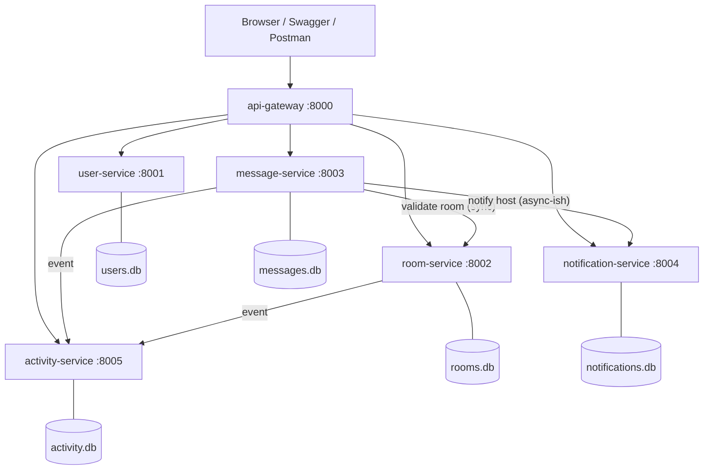
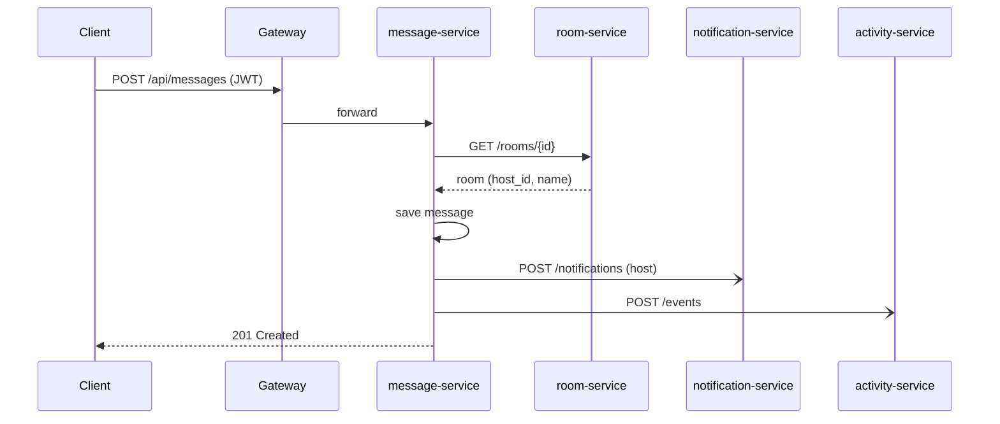

# Architecture

## Scenario to service mapping (Lab 01, Part A)

| Business scenario | Owning microservice | Port |
|---|---|---|
| User registers / logs in / edits profile | user-service | 8001 |
| User creates and browses rooms and topics | room-service | 8002 |
| User posts messages in a room | message-service | 8003 |
| Room host is notified of new messages | notification-service | 8004 |
| Users see platform activity and stats | activity-service | 8005 |
| Clients reach everything through one door | api-gateway | 8000 |

## Diagram

## Sequence: posting a message

## Design decisions (for the viva)
- **Database per service**: no shared tables and no cross-service foreign keys. Services store `user_id` / `host_name` copies instead of joining; this is what the monolith's `ForeignKey(User)` had to be replaced with.
- **API gateway**: one public entry point; services are not exposed to the host in Docker Compose.
- **Stateless JWT auth**: no session sharing between services.
- **Graceful degradation**: only the room lookup is critical for posting; notifications and activity are best-effort.
- **Health endpoints**: every service has `/health`; gateway aggregates them.
- **Containerisation**: one Dockerfile per service, one `docker-compose.yml` for the system.

## Possible improvements (stretch goals)
- Replace the best-effort HTTP calls with a message broker (RabbitMQ / Redis streams).
- PostgreSQL per service instead of SQLite.
- Kubernetes manifests (the original project name hinted at K8S).
- Rate limiting and JWT validation in the gateway.
